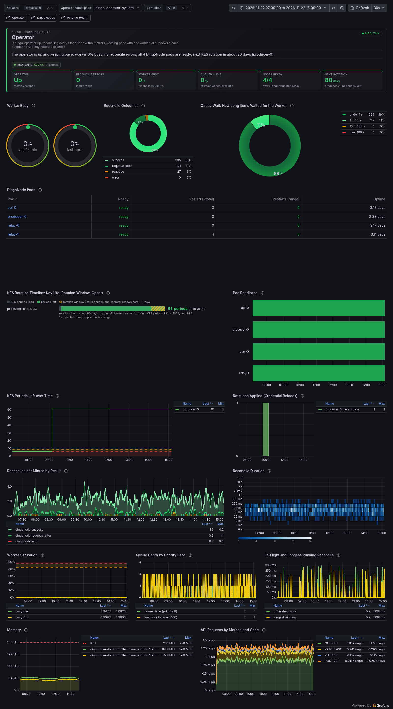
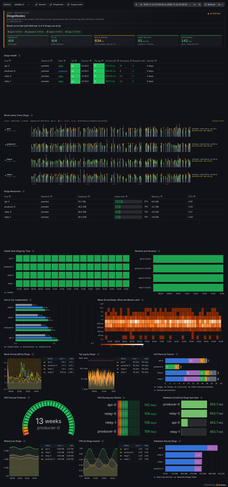
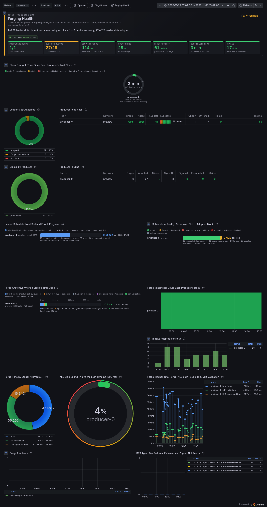

# dingo-operator Grafana dashboards and alerts

Monitoring material for [dingo-operator](../../README.md) and the `DingoNode`s it
manages, on Kubernetes with the Prometheus Operator.

## Dashboards

| Dashboard | File | uid | Description |
|-----------|------|-----|-------------|
| **Operator** | `dingo-operator.json` | `dingo-operator` | Controller and reconcile health, work queue, KES rotation timeline, DingoNode pod readiness |
| **DingoNodes** | `dingonodes.json` | `dingonodes` | Fleet view: sync and tip, block arrival, peers, storage runway, resources |
| **Forging Health** | `dingo-forging-health.json` | `dingo-forging` | Producer readiness, leader slots to adopted blocks, forge timing, remote signing agent |

The three dashboards link to each other from the top bar. The links keep the
time range and the template variables.

The screenshots below were rendered from synthetic metrics for one network
with two relays, an API node and a block producer.

| Operator | DingoNodes | Forging Health |
|----------|------------|----------------|
| [](screenshots/dingo-operator.png) | [](screenshots/dingonodes.png) | [](screenshots/dingo-forging-health.png) |

`alerts.yaml` holds the Prometheus rules and `alerts_test.yaml` their
[promtool](https://prometheus.io/docs/prometheus/latest/configuration/unit_testing_rules/)
unit tests.

## Prerequisites

- **Grafana 12+**.
- **Prometheus Operator** (kube-prometheus-stack or standalone), so the
  `PodMonitor` custom resource exists.
- **dingo-operator metrics scraped.** Install the
  [dingo-operator chart](https://github.com/blinklabs-io/helm-charts) with
  `podMonitor.enabled=true`. The chart's PodMonitor scrapes the operator's
  controller-runtime metrics. With `metrics.secure` (the chart default) it
  presents the token of a `metrics-scraper` ServiceAccount that the chart binds
  to the `metrics-reader` ClusterRole. Set `podMonitor.labels` to match your
  Prometheus `podMonitorSelector`; kube-prometheus-stack selects on its
  `release` label by default.
- **DingoNode metrics scraped.** Set `spec.metrics.podMonitor.enabled: true` on
  each DingoNode. The operator then creates a PodMonitor that adds the pod's
  `cardano_network` and `cardano_service` labels and every `spec.podLabels` key
  to the series, and sets `instance` to the pod name. That PodMonitor carries
  only the operator's own labels, so Prometheus must select PodMonitors without
  a `release` label: in kube-prometheus-stack set
  `prometheus.prometheusSpec.podMonitorSelectorNilUsesHelmValues: false`.
  Prometheus must also be
  allowed through the node's NetworkPolicy: label its pods (and namespace, when
  it differs from the node's) `dingo.blinklabs.io/metrics=allowed`.
- **[kube-state-metrics](https://github.com/kubernetes/kube-state-metrics)**
  for pod, container and StatefulSet state. Dingo pods are identified from
  `kube_pod_spec_volumes_persistentvolumeclaims_info{volume="dingo-data"}`,
  which comes from the pod spec, so a pod that cannot start (for example on an
  unbound claim) still counts as not ready, and from a started container named
  `dingo` or a `dingo_build_info` series, which cover a StatefulSet that kept an
  older claim template name.
- **Kubelet volume stats** (`kubelet_volume_stats_*`, scraped from the kubelet
  by default in kube-prometheus-stack) for the storage runway panels, and
  cAdvisor container metrics for memory and CPU.
- **[Business Text plugin](https://grafana.com/grafana/plugins/marcusolsson-dynamictext-panel/)**
  (`marcusolsson-dynamictext-panel`) for every dashboard header and several
  panels. They render with Grafana's default HTML sanitizing;
  `disable_sanitize_html` is not needed.
- **A Prometheus datasource with uid `default`.** Every panel references
  `{"type": "prometheus", "uid": "default"}`, as the Dingo dashboards do.
  Provision the datasource with that uid, or replace `default` in the JSON
  with your datasource's uid before importing.

Install the plugin on Kubernetes with the environment variable
`GF_INSTALL_PLUGINS=marcusolsson-dynamictext-panel`, or through the Grafana
chart's `plugins:` value.

## Install

### Option A: Grafana sidecar ConfigMaps

The Grafana sidecar loads every ConfigMap labelled `grafana_dashboard=1`
(kube-prometheus-stack enables it by default; the label and namespace scope are
configurable in the chart).

```bash
for f in dingo-operator dingonodes dingo-forging-health; do
  kubectl -n monitoring create configmap "dashboard-$f" \
    --from-file="docs/dashboards/$f.json"
  kubectl -n monitoring label configmap "dashboard-$f" grafana_dashboard=1
  kubectl -n monitoring annotate configmap "dashboard-$f" \
    grafana_folder="Dingo Operator"
done
```

The `grafana_folder` annotation needs the sidecar's
`sidecar.dashboards.folderAnnotation: grafana_folder` setting. Each dashboard
is under 250 KB, well inside the 1 MiB ConfigMap limit.

### Option B: file provisioning

Copy the dashboards to a directory Grafana reads and add the provider in
`provisioning.yaml`:

```bash
sudo cp docs/dashboards/provisioning.yaml /etc/grafana/provisioning/dashboards/dingo-operator.yaml
sudo mkdir -p /var/lib/grafana/dashboards/dingo-operator
sudo cp docs/dashboards/*.json /var/lib/grafana/dashboards/dingo-operator/
sudo chown -R grafana:grafana /var/lib/grafana/dashboards/dingo-operator/
sudo systemctl restart grafana-server
```

On Kubernetes, mount the same files into the Grafana pod, for example from a
ConfigMap, and mount `provisioning.yaml` under
`/etc/grafana/provisioning/dashboards/`. Dashboards appear in the **Dingo
Operator** folder within about 30 seconds.

`allowUiUpdates: true` lets you edit dashboards in the UI, but a provisioning
cycle overwrites the change. Edit the JSON files for permanent changes.

### Option C: manual import

In Grafana choose **Dashboards, New, Import** and upload each JSON file.

## Alerts

`alerts.yaml` has 15 rules in three groups: the operator, DingoNodes (pod
readiness, rollouts, volumes) and block producers (KES rotation, opcert,
credentials, signing agent, missed leader slots). The operator's series are
found by `controller="dingonode"`, so no job name is assumed. Node-level sync
and peer alerts live in Dingo's own
[`docs/dashboards/alerts.yaml`](https://github.com/blinklabs-io/dingo/tree/main/docs/dashboards);
load both files.

With the Prometheus Operator, wrap the groups in a `PrometheusRule`:

```yaml
apiVersion: monitoring.coreos.com/v1
kind: PrometheusRule
metadata:
  name: dingo-operator
  namespace: monitoring
  labels:
    release: kube-prometheus-stack   # match your Prometheus ruleSelector
spec:
  groups:
    # paste the contents of the `groups:` list from alerts.yaml
```

Without it, copy `alerts.yaml` to the Prometheus rules directory and list it
under `rule_files:` in `prometheus.yml`.

The KES thresholds assume the default `rotation.renewBeforePeriods: 8`. If a
DingoNode sets another value, adjust `DingoKESRotationDue` and
`DingoKESRotationNotProgressing` to match. Only rotation mode Auto renews a
key; MonitorOnly, the default, reports and never renews.

Run the unit tests with:

```bash
cd docs/dashboards
promtool check rules alerts.yaml
promtool test rules alerts_test.yaml
```

## Datasource

All dashboards reference their Prometheus datasource with UID `default`,
Grafana's built-in alias for the datasource currently marked as default. With
one Prometheus datasource, or one marked default under **Connections, Data
sources**, the dashboards resolve it without renaming a UID.

## Template variables

| Variable | Dashboards | Source | Purpose |
|----------|-----------|--------|---------|
| `$network` | all | `cardano_network` label | Selects the Cardano network. The operator's PodMonitor adds this label from `spec.network`. Multi-select, default All. |
| `operator_namespace` | Operator | `label_values(controller_runtime_reconcile_total{controller="dingonode"}, namespace)` | The namespace the operator runs in. Selects its controller-runtime series. |
| `controller` | Operator | `label_values(controller_runtime_reconcile_total{namespace="$operator_namespace"}, controller)` | The controller shown in the reconcile panels. |
| `$pod` | Forging Health | `label_values(dingo_forge_credentials_valid{cardano_network=~"$network"}, pod)` | Selects block producers. Only pods that report `dingo_forge_credentials_valid` appear. |
| `kes_sign_timeout_ms` (hidden constant) | Forging Health | constant `500` | The producers' KES agent sign timeout in milliseconds. |

Panels group by the `pod` label, so no labels beyond the operator's own are
required. The DingoNodes dashboard also defines hidden helper variables
(`syncing`, `producers`, `versions`, `kes_min`, `kes_min_pod`, `arrival_p50`,
`runway_min`, `runway_pod`) that fill the dashboard header text from
Prometheus.

### Changing the KES sign timeout

`kes_sign_timeout_ms` defaults to 500, Dingo's default for
`CARDANO_SHELLEY_KES_AGENT_SIGN_TIMEOUT`. If your producers set a different
timeout, open **Forging Health, Dashboard settings, Variables**, edit the
constant `kes_sign_timeout_ms` to the same value and save. The *KES Sign Round
Trip vs the Sign Timeout* panel divides the measured round trip by it. In the
JSON file the value is the `query` of the `kes_sign_timeout_ms` entry under
`templating.list`.

## Dormant panels

Some panels show "No data" or a waiting message until the metrics they read
exist.

| Panels | Needs |
|--------|-------|
| Leader schedule: next slot, epoch progress, scheduled vs adopted, scheduled slots never checked, signer not ready (`dingo_leader_*`, `dingo_forge_remote_kes_signer_not_ready_total`) | A newer Dingo release than the one that lacks these metrics. They fill in after an upgrade. |
| KES agent: sign round trip, dial failures, agent signs, agent connected (`dingo_kes_agent_*`) | A producer with `spec.blockProducer.signingAgent`. Producers with local KES keys never emit them. |
| KES rotation timeline, KES periods left, opcert counters | A producer with a KES key and opcert loaded. |
| KES rotation timeline: agent key rows (`bursa_kesagent_last_period`, `bursa_kesagent_current_period`, `bursa_kesagent_opcert_issue_number`) | The bursa KES agent's metrics scraped. They carry a `profile` label, not the producer pod, so they are listed on their own rows; replicas that report different last periods or issue numbers are flagged. |
| Forge Anatomy: agent split (network and TLS, agent sign, slot guard) | Agent-side series keyed by agent profile. No query in the dashboard reads them, so the sign round trip shows as one stage. When a block was rejected in self-validation, the stage split is withheld and the averages are listed separately. |
| Slot battles, validation failures, stale tip skips | Series appear only after the first event; a flat baseline is the healthy state. |

The dashboards show only DingoNodes that report the metrics a panel reads:
relays do not appear in Forging Health.

DingoNode status conditions (`Ready`, `Degraded`, `KeysValid`, `RotationDue`),
the rotation mode and `status.opcert` live on the DingoNode object, not in
metrics. The operator exports no metrics of its own beyond controller-runtime's.
"Rotation due" is therefore derived from
`cardano_node_metrics_remainingKESPeriods_int <= 8`.

## File listing

```text
docs/dashboards/
  dingo-operator.json          Operator dashboard
  dingonodes.json              DingoNodes dashboard
  dingo-forging-health.json    Forging Health dashboard
  provisioning.yaml            Grafana file provisioning provider
  alerts.yaml                  Prometheus alert rules
  alerts_test.yaml             promtool unit tests for alerts.yaml
  screenshots/                 Dashboards rendered from synthetic metrics
  README.md                    This file
```

## Troubleshooting

**"Panel plugin not found: marcusolsson-dynamictext-panel"**
Install the Business Text plugin and restart Grafana.

**Headers show static text and no pills or numbers**
The panel's queries failed or its script did not run. Check that a datasource
with uid `default` exists (see Prerequisites), then look for errors in the
browser console.

**Every panel shows "No data"**
In Prometheus open **Status, Targets** and confirm the DingoNode PodMonitor
targets are up. If they are down with a connection or timeout error, the
node's NetworkPolicy is blocking Prometheus: label the Prometheus pods
`dingo.blinklabs.io/metrics=allowed`. Then check the `$network` variable.

**Operator dashboard is empty but the node dashboards work**
The operator's PodMonitor is not scraped. Check `podMonitor.enabled` in the
chart, that the Prometheus `podMonitorSelector` selects it, and that the
`metrics-scraper` token is accepted. `operator_namespace` stays empty until
`controller_runtime_reconcile_total{controller="dingonode"}` exists.

**Storage runway panels are empty**
They need kubelet volume stats for claims named `dingo-data-<pod>` and
kube-state-metrics. Confirm `kubelet_volume_stats_available_bytes` exists
in Prometheus. Some CSI drivers do not report it. A StatefulSet created by an
earlier operator version keeps claims named `data-<pod>`, which the panels and
the volume alerts do not match.

**Panels collapse to one series**
Panels group by `pod`. Check that the scraped series carry a `pod` label; a
PodMonitor that relabels it away breaks them.

**"datasource not found"**
Mark your Prometheus datasource as default under **Connections, Data sources**,
or replace `"uid": "default"` in the JSON files with your datasource UID.

**Dashboards do not appear (sidecar)**
Check that the ConfigMap carries `grafana_dashboard=1` and sits in a namespace
the sidecar watches, then read the `grafana-sc-dashboard` container log.

**Dashboards do not appear (provisioning)**
Confirm the provider file points at the directory holding the JSON files and
read the Grafana log. Grafana rescans every 30 seconds.
